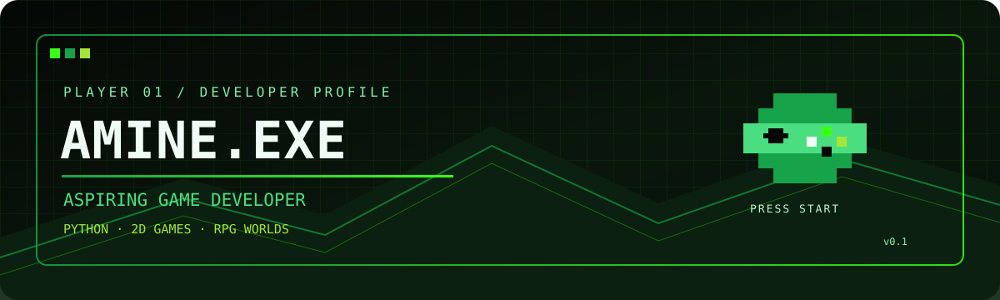

  

<h1 align="center">AMINE.EXE</h1>

  <strong>Aspiring Game Developer | Python Learner</strong>

  
  
  

---

## 🕹️ 01 // PLAYER PROFILE

Hi! I'm **Amine**, a programming learner working toward becoming a game developer.

- 🐍 Currently learning Python
- 🎮 Interested in 2D game development
- 🧙 Exploring RPG mechanics and game design
- 💡 Goal: turn ideas into playable experiences

> Learn. Build. Test. Improve. Repeat.

## 🎯 02 // CURRENT QUEST

| Quest | Status |
|---|---|
| Learn Python fundamentals | In progress |
| Practise problem-solving | In progress |
| Explore 2D game development | Next objective |
| Build my first playable game | Upcoming |

## 💾 03 // SKILL INVENTORY

- **Python:** Learning
- **Game development:** Exploring
- **2D games:** Interested
- **RPG design:** Interested

## 🎮 04 // PROJECT ARCHIVE

### First playable game — Coming soon

My goal is to build a small 2D game while practising programming fundamentals and game logic.

*Projects will be added here as I build them.*

## 🚀 05 // NEXT LEVEL

- [ ] Strengthen my Python fundamentals
- [ ] Build small practice projects
- [ ] Create my first playable 2D game
- [ ] Share my projects on GitHub
- [ ] Improve through feedback and practice

---

  <strong>GAME STATUS: IN DEVELOPMENT</strong> 
  Every great game starts with a first build.

<!--
**amine213maahe/amine213maahe** is a ✨ _special_ ✨ repository because its `README.md` (this file) appears on your GitHub profile.

Here are some ideas to get you started:

- 🔭 I’m currently working on ...
- 🌱 I’m currently learning ...
- 👯 I’m looking to collaborate on ...
- 🤔 I’m looking for help with ...
- 💬 Ask me about ...
- 📫 How to reach me: ...
- 😄 Pronouns: ...
- ⚡ Fun fact: ...
-->
